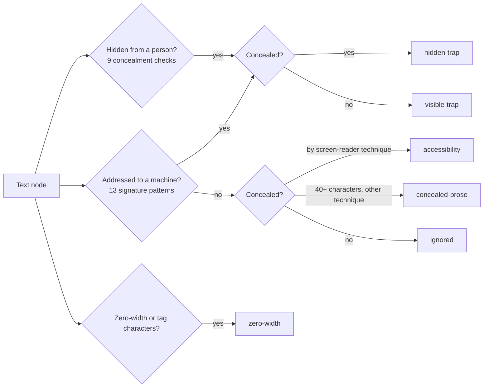
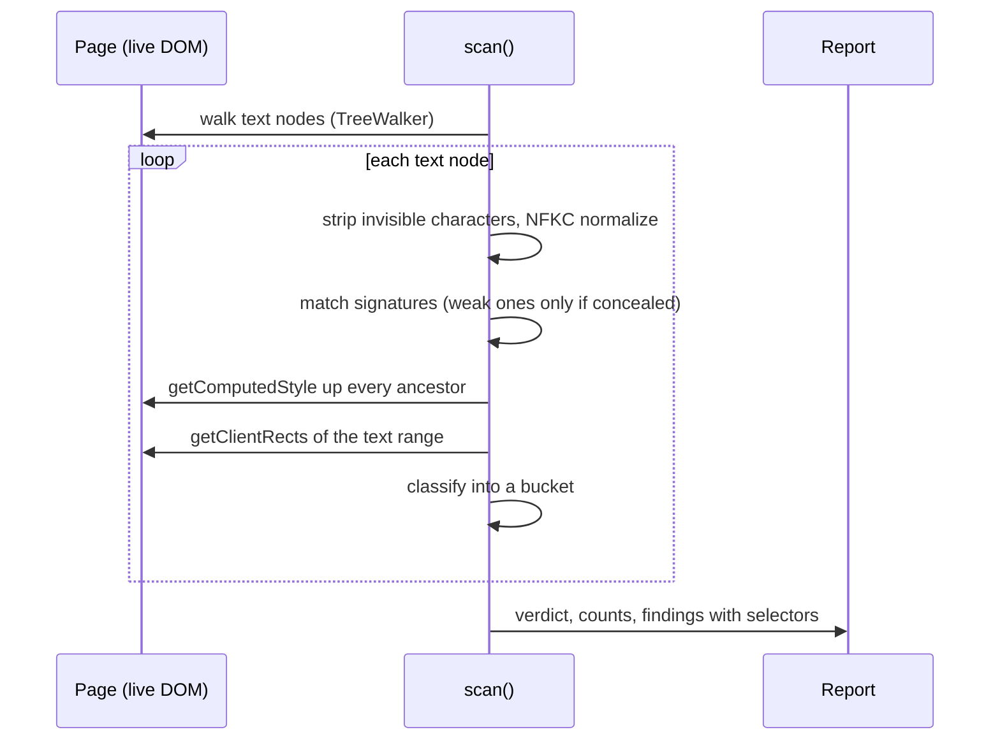
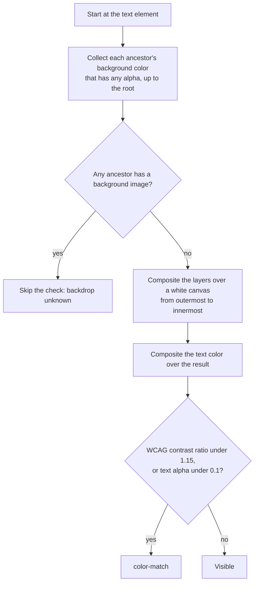
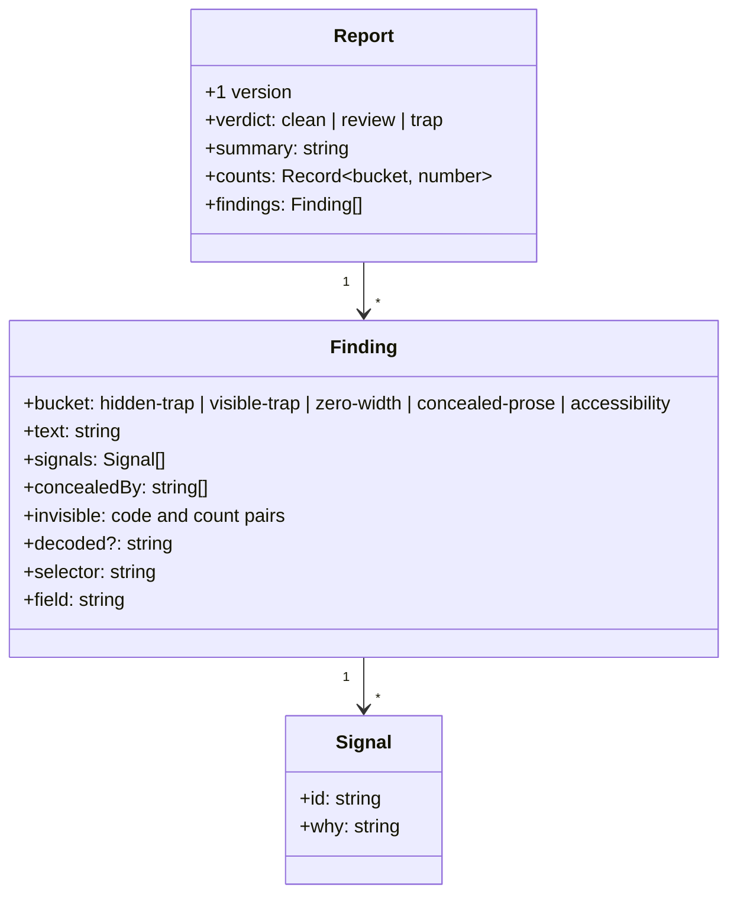
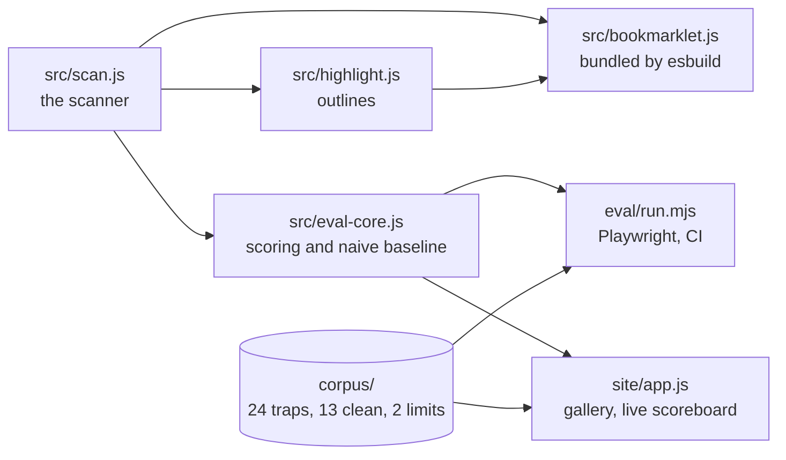

# Architecture

`prompt-trap-scan` is one function, `scan(document)`, with no dependencies. It needs a DOM that computes layout, so it runs in a real browser or in Playwright, not in jsdom.

## The idea: two independent questions

Every text node gets two separate checks. The answers combine into a bucket.

Keeping the axes apart is the point. A single "is it hidden" rule flags every mobile menu and skip link. A single "does it mention an AI" rule flags every article about AI. A trap is the overlap.

## Pipeline

The walk skips `script`, `style`, `template`, `noscript` and `option` text. Closed `select` options are zero-size by nature, and flagging them teaches readers to ignore the report.

## The nine concealment checks

Display, opacity, clipping and size do not inherit, yet they hide every descendant. So each check walks the ancestor chain, not only the element that holds the text.

| Check | What it looks at |
|---|---|
| `display-none` | computed `display` on any ancestor |
| `visibility-hidden` | computed `visibility` on the element |
| `zero-opacity` | product of `opacity` over all ancestors, under 0.1 |
| `tiny-font` | computed `font-size` under 4px |
| `color-match` | text color against the effective background (below) |
| `text-indent` | `text-indent` of -500px or further |
| `clipped` | `clip-path: inset(50%+)`, `circle(0)`, or `clip: rect(0,0,0,0)` on any ancestor |
| `offscreen` | the laid-out text rectangles lie wholly off the page |
| `zero-size` | an ancestor that clips overflow and is 1px or less in a dimension, or a zero scale transform |

## The color-ancestry check

Text is invisible when it matches what is behind it, and what is behind it is rarely the element's own background. The check:

A contrast ratio is used instead of a channel-difference threshold. Dark themes with light text pass, light gray footers pass, and near-white on cream fails, which a raw RGB distance gets wrong in both directions.

## Invisible characters

Three sets, handled apart because their false-positive profiles differ.

- Always flagged: U+200B, U+2060, U+180E, U+FEFF.
- Flagged only beside an ASCII letter or digit: U+200C and U+200D. Emoji sequences and Persian or Hindi text use them legitimately.
- Unicode tag block U+E0000 to U+E007F: each code point maps to ASCII, so the scanner decodes the run and judges the decoded text against the same signatures. This is how an instruction rides invisibly inside a normal sentence.

Before signature matching, all of these are stripped and the text is NFKC-normalized, so a keyword split with zero-width spaces is read as the plain phrase.

## Screen-reader text

Hiding text from sighted users is what `sr-only` is for. The scanner routes it to its own `accessibility` bucket when it recognizes the technique (clipped to a tiny box, or parked offscreen) or the class name. Two rules keep this from becoming a loophole:

1. Recognition is by technique first. A trap does not escape by choosing an unusual class name.
2. A signature match always wins. Text that addresses a machine and is concealed is a `hidden-trap`, even inside `.sr-only`.

## Report schema

Verdict is `trap` if any `hidden-trap`, `visible-trap` or `zero-width` finding exists, `review` if only `concealed-prose` exists, otherwise `clean`. Findings carry a CSS `selector` rather than an element, so the report is plain JSON and survives crossing a process boundary.

## Where each file sits

The same scoring code runs in CI and in the gallery, so the number on the page is the number the build checked.
